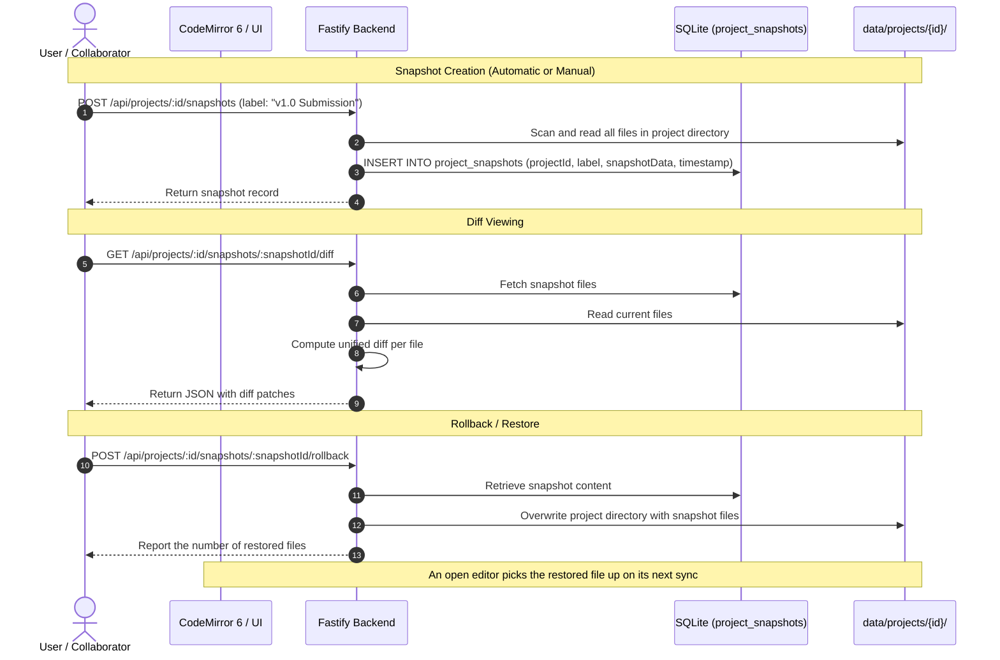
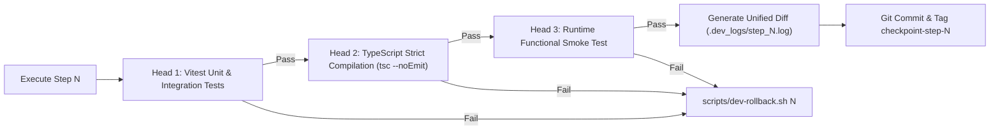

# freeLatex System Architecture & Design Specification

This document details the architectural principles, protocols, data flows, security models, and verification systems of **freeLatex**—a 100% free-tier, portable, self-hostable collaborative LaTeX workspace with Overleaf and LetX capabilities.

---

## 1. Core Architecture Diagram

```mermaid
flowchart TB
    subgraph Browser ["Client Browser (React 19 + CodeMirror 6 + PDF.js)"]
        UI["Editor & Workspace UI"]
        CM["CodeMirror 6 LaTeX Editor"]
        YDoc["Yjs CRDT Document"]
        PDFV["PDF.js Viewer + SyncTeX Overlay"]
        WasmCompiler["Client-Side BusyTeX Wasm Compiler (Worker)"]
        AIService["AI Assistant (BYOK Client: Gemini Free Tier / OpenAI / Claude)"]
        HistoryUI["Version Control & Diff Viewer"]

        UI --- CM
        CM <--> YDoc
        UI --- PDFV
        UI --- AIService
        UI --- HistoryUI
        UI -->|Fast preview| WasmCompiler
        WasmCompiler -->|Render PDF Blob| PDFV
    end

    subgraph Server ["freeLatex Server (Node.js / Fastify :3030)"]
        Gateway["HTTP & WebSocket Gateway"]
        AuthMid["Dual-Mode Auth & Token Validator"]
        YServer["Yjs WebSocket Room Provider"]
        TectonicRunner["Server Tectonic LaTeX Runner"]
        SyncTeXEngine["SyncTeX Parser (synctex-js)"]
        SnapshotEngine["Version Control & Diff Service"]
        ProjectFS["Disk Storage (data/projects/&lt;id&gt;/)"]
        SQLite[(SQLite DB: freelatex.db)]

        Gateway --> AuthMid
        AuthMid --> YServer
        AuthMid --> TectonicRunner
        AuthMid --> SnapshotEngine
        AuthMid --> ProjectFS
        AuthMid --> SQLite

        YServer <--> ProjectFS
        SnapshotEngine <--> ProjectFS
        SnapshotEngine <--> SQLite
        TectonicRunner --> SyncTeXEngine
        TectonicRunner --> ProjectFS
    end

    subgraph External ["AI Provider (Optional BYOK)"]
        LLM["Google Gemini (AI Studio) / OpenAI / Anthropic"]
    end

    YDoc <-->|Multiplayer Binary WS| Gateway
    CM -->|SyncTeX Forward Jump| PDFV
    PDFV -->|SyncTeX Inverse Jump| CM
    UI -->|Compile (Server Mode)| Gateway
    Gateway -->|PDF Stream + SyncTeX Data| PDFV
    AIService -->|Prompt + key in a header| Gateway
    Gateway -->|Provider key in its own header| LLM
```

The assistant's key lives in the browser and is never stored by the server.
The browser sends it to the server's `/api/ai/complete` route in a header of
its own, because the `Authorization` header already carries the workspace's
own key; the server forwards it to the provider and keeps nothing. A shared
link cannot reach that route, so a share token never spends the owner's
paid provider key.

---

## 2. 100% Free-Tier Architecture Breakdown

freeLatex is engineered to run at **zero recurring software or API cost**:

| Component | Free-Tier Technology | Cost | Description |
|---|---|---|---|
| **LaTeX Engine (Server)** | **Tectonic** | **$0** | Open-source compiler that auto-downloads only the CTAN packages actually imported by the document. |
| **LaTeX Engine (Client)** | **BusyTeX WebAssembly** | **$0** | Compiles in the user's browser thread; zero server CPU and works offline. |
| **AI Assistant** | **Google Gemini Free Tier (BYOK)** | **$0** | 15 RPM / 1 million TPM free via Google AI Studio API key. Users input their own key; server incurs $0 cost. |
| **Real-time Sync** | **Yjs + Fastify WebSockets** | **$0** | Self-hosted CRDT synchronization. No paid services (e.g. Liveblocks/Pusher). |
| **Database** | **SQLite (`better-sqlite3`)** | **$0** | Single file on disk (`freelatex.db`). No hosted DB fees. |
| **Storage** | **Local Filesystem** | **$0** | Source files stored as plain text under `data/projects/{id}/`. |

---

## 3. In-Product Version Control & Diff Architecture

freeLatex provides full document revision history inspired by Overleaf:



---

## 4. Dual-Mode Authentication Engine

freeLatex supports two operational topologies governed by `AUTH_MODE`:

### Mode 2-A: Single-Host Personal Mode (`AUTH_MODE=single`)
- Master credential: `ADMIN_API_KEY`.
- The instance owner has full control over all documents.
- Ideal for personal self-hosting on a home server, VPS, or local machine.

### Mode 2-C: Multi-User Tenant Mode (`AUTH_MODE=multi`)
- Master admin provisions personal **User API Keys** (`sk_user_...`).
- Queries are strictly scoped by tenant (`owner_id = user.id`).
- Projects, files, and quotas are isolated between users.

### What a credential can reach

Every route that touches project data asks `canAccessProject` before it
reads or writes anything, and the collaboration socket asks the same
question with `write: true`, so a read-only link is refused there as well.

| Credential | Reaches |
|---|---|
| `ADMIN_API_KEY` | Every project, plus the admin routes that provision and revoke user keys. |
| `sk_user_...` | Only the projects whose `owner_id` is that user. |
| `rw_...` share token | Exactly one project, and may write in it. It may not reach the admin routes, and it may not spend the owner's AI key. |
| `ro_...` share token | Exactly one project, and may only read it. It may not compile, may not change anything, and is refused at the collaboration socket. |

### The guards around the edges

- **The log never holds a credential.** The browser's WebSocket API cannot
  set a header, so a share token travels in the query string of the upgrade
  request — and the request's URL is part of every log line. The logger's
  request serializer keeps the path and drops the query string, so the token
  stays out of the logs while the request is still traceable.
- **Cross-origin access is off unless it is named.** `CORS_ORIGIN` names
  the single origin that may call the API from a browser; unset, no origin
  is allowed at all. Reflecting whatever origin asks would let any site on
  the internet read the API's answers on the user's behalf.
- **The sign-in endpoint is throttled.** Ten failures from one address in a
  minute, and the eleventh attempt is refused. The keys are long random
  strings and cannot be guessed, but an unthrottled endpoint is still an
  oracle.
- **The compiler is bounded.** A compilation runs for at most
  `COMPILE_TIMEOUT_MS` and prints at most 4 MiB, and no more than a few of
  them run at the same time — a client that asks for a hundred builds at
  once waits its turn rather than taking every core of the server. The
  compiler is spawned with an argument array and no shell, so a document
  cannot run a command.

---

## 5. Development Multi-Headed Verification & Rollback Protocol

Every micro-step during implementation is verified by **3 independent verification heads**:



- **Head 1 (Automated Test & Contract Verification)**: Executes unit and contract tests in `vitest`.
- **Head 2 (Static Analysis & Type Integrity)**: Runs `tsc --noEmit` and linter checks with zero warnings/errors.
- **Head 3 (Runtime Functional Probe)**: Boots the actual service, executes HTTP/WebSocket probes, and tests disk I/O.
- **Rollback Tool (`scripts/dev-rollback.sh`)**: If any head fails, reverts to `checkpoint-step-<N-1>` instantaneously.
