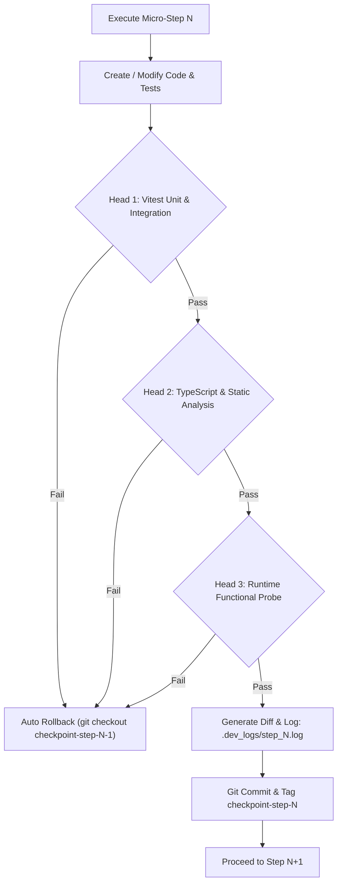
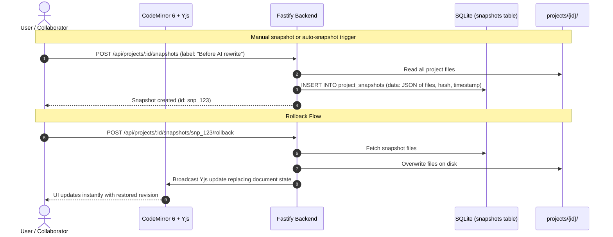

# Implementation Plan: freeLatex (Portable Collaborative LaTeX Workspace)

**freeLatex** (located at `/home/biloi/Projects/freeLatex`) is a 100% free-tier, self-hostable, portable, real-time collaborative LaTeX workspace combining Overleaf (multi-file editing, PDF preview, bidirectional SyncTeX, document version control, frictionless link sharing) and LetX (modern UI, AI-assisted writing & error auto-fixing via free-tier APIs).

---

## 1. Goal Description

Deliver an end-to-end, production-ready portable LaTeX platform with:
1. **100% Free-Tier Guarantee**:
   - Zero paid subscriptions, zero paid API requirements.
   - Local Tectonic compiler (free, auto-downloads free CTAN packages) + BusyTeX WebAssembly (client-side in-browser, 0 cost). *(The plan originally named SwiftLaTeX; the implementation uses `texlyre-busytex` — see the Step 9 deviation.)*
   - AI features use **Google Gemini Flash free tier quota** (via Google AI Studio free API key), OpenAI or Anthropic, strictly client-side BYOK. *(The plan originally named local Ollama; it is not implemented — the three supported providers are Gemini, OpenAI and Anthropic.)*
   - Database: Local SQLite file (`freelatex.db`). Zero external cloud dependencies.
2. **Dual-Mode Backend Personalization**:
   - **Single-Host Mode (`AUTH_MODE=single`)**: Powered by a single `ADMIN_API_KEY`. Instant zero-config private instance for a single user/researcher.
   - **Multi-Tenant Mode (`AUTH_MODE=multi`)**: Admin can issue individual **User API Keys** (`sk_user_...`). Each key owns an isolated workspace (`owner_id`), allowing multiple distinct users to use the same backend independently.
3. **Overleaf-Style In-Product Version Control & Diff Viewer**:
   - Snapshot engine: manual named revisions ("Submission Draft", "Before Revision"). *(The plan originally named automatic timed snapshots; they are not implemented — a snapshot is made when the user asks for one.)*
   - Side-by-side and unified diff viewer between any two revisions.
   - One-click rollback: Restores project files on disk. *(The plan originally said the change is broadcast across active Yjs sessions; it is not — an open editor picks the restored file up on its next sync.)*
4. **Frictionless Link Sharing**:
   - Owners generate Read/Write or Read-Only tokens (`?token=rw_...` or `?token=ro_...`) with optional expiration. Collaborators join live rooms immediately without accounts or API keys.
5. **Multi-Headed Development Verification & Rollback Protocol**:
   - Every individual micro-step during development is validated by **3 independent verification heads**:
     - **Head 1 (Automated Test / Contract Verification)**: Vitest unit & integration test suite.
     - **Head 2 (Static Integrity & Type Safety)**: TypeScript strict check (`tsc --noEmit`), lint checks, dependency validation.
     - **Head 3 (Runtime Functional Smoke Test)**: Server execution, endpoint probe via curl, WebSocket handshake, disk I/O verification.
   - Atomic Git checkpoints (`git tag checkpoint-step-XX`) and an automated rollback script (`scripts/dev-rollback.sh`) with detailed step review logs (`.dev_logs/step_N.log` and `.dev_logs/step_N.patch`).

---

## 2. Multi-Headed Verification & Development Rollback Protocol

To guarantee zero regression and instant rollback during implementation:



### Verification Scripts:
- **`scripts/verify-step.sh <step_number>`**: Executes Head 1 (vitest), Head 2 (`tsc --noEmit`), and Head 3 (runtime probe). Only if all three return exit code 0 does it log success, create the diff patch, and tag the commit.
- **`scripts/dev-rollback.sh <step_number>`**: Reverts the repository to `checkpoint-step-<step_number - 1>` and purges unstaged modifications.

---

## 3. In-Product Version Control Architecture



---

## 4. User Review Required

> [!IMPORTANT]
> **100% Free-Tier Architecture**:
> - All software components are MIT/Open-Source.
> - Compilation uses Tectonic (free binary with free on-demand CTAN caching) and BusyTeX WebAssembly (client-side, zero hosting cost).
> - AI keys are user-supplied (BYOK) with support for **Google Gemini's generous Free Tier** (15 RPM / 1 million TPM free via Google AI Studio). No paid backend AI gateway is required.

> [!IMPORTANT]
> **Independent Package Structure**:
> Per your selection, `client/` and `server/` are two separate packages with their own `package.json` files and independent dependencies (no shared root workspace).

---

## 5. Granular Micro-Step Execution Roadmap

The implementation is broken down into **10 granular, sequential micro-steps**. Each step will be individually implemented, verified via the 3-headed protocol, logged with a diff, and tagged in git.

---

### Step 0: Repository Initialization & Development Safety Harness
- **0.1**: Initialize git repository in `/home/biloi/Projects/freeLatex`.
- **0.2**: Create comprehensive `.gitignore` (ignoring `node_modules/`, `data/`, `*.log`, `build/`, `.env`).
- **0.3**: Create `scripts/verify-step.sh` (Multi-headed verification harness).
- **0.4**: Create `scripts/dev-rollback.sh` (One-command rollback tool).
- **0.5**: Create `.dev_logs/` directory for diff logs.
- **Verification**: Run `scripts/verify-step.sh 0` (verifies git state, script permissions).
- **Tag**: `checkpoint-step-00-git-init`.

---

### Step 1: Server Package Bootstrap & Environment Layer
- **1.1**: Initialize `server/package.json` with exact verified dependencies (`fastify`, `@fastify/websocket`, `@fastify/cors`, `@fastify/static`, `@fastify/multipart`, `better-sqlite3`, `drizzle-orm`, `nanoid`, `dotenv`, etc.).
- **1.2**: Configure `server/tsconfig.json` with strict type checking.
- **1.3**: Implement `server/src/config/env.ts` (Validates `ADMIN_API_KEY`, `AUTH_MODE`, `PORT=3030`, `HOST`, `DATA_DIR`, `COMPILE_TIMEOUT_MS`, `NODE_ENV`, `STATIC_DIR`, `CORS_ORIGIN`).
- **1.4**: Create `server/.env.example`.
- **Verification**:
  - Head 1: Unit test for env parsing and validation logic.
  - Head 2: `tsc --noEmit` on `server/`.
  - Head 3: Script loads env module and verifies correct defaults.
- **Tag**: `checkpoint-step-01-server-bootstrap`.

---

### Step 2: Database Schema & Drizzle ORM Setup
- **2.1**: Configure `server/drizzle.config.ts`.
- **2.2**: Implement `server/src/db/schema.ts`:
  - `users`: `id`, `api_key_hash`, `name`, `role`, `created_at`.
  - `projects`: `id`, `owner_id`, `title`, `main_file`, `created_at`, `updated_at`.
  - `share_tokens`: `id`, `project_id`, `token`, `permission`, `label`, `created_at`, `expires_at`.
  - `project_snapshots` (In-Product Version Control): `id`, `project_id`, `label`, `snapshot_data`, `created_by`, `created_at`.
- **2.3**: Implement `server/src/db/index.ts` (SQLite connection via `better-sqlite3`, auto-creates tables on boot).
- **2.4**: Implement `server/src/utils/hash.ts` (SHA-256 key hasher).
- **Verification**:
  - Head 1: Database CRUD tests for all 4 tables in `vitest`.
  - Head 2: Strict type check `tsc --noEmit`.
  - Head 3: Runtime verification creating in-memory DB and inserting/querying a project with a snapshot.
- **Tag**: `checkpoint-step-02-database-schema`.

---

### Step 3: Dual-Mode Authentication & Share Token Middleware
- **3.1**: Implement `server/src/middleware/auth.ts`:
  - Validates `Authorization: Bearer <ADMIN_API_KEY>` (Single-host mode or Admin).
  - Validates `Authorization: Bearer <sk_user_...>` (Multi-tenant user mode).
  - Validates `?token=rw_...` or `?token=ro_...` against `share_tokens` table (collaborators).
- **3.2**: Implement `server/src/routes/auth.ts`:
  - `POST /api/auth/login`: Validates key, returns user session.
  - `GET /api/auth/me`: Returns caller role and identity.
  - `POST /api/auth/keys`: Admin provisions new user keys (in multi-user mode).
- **3.3**: Implement `server/src/routes/share.ts`:
  - `POST /api/projects/:id/share`: Generates Read/Write or Read-Only token with optional expiry.
  - `GET /api/projects/:id/share`: Lists active share tokens.
  - `DELETE /api/projects/:id/share/:tokenId`: Revokes share token.
- **Verification**:
  - Head 1: Integration tests for Admin auth, User auth, Share token auth, and expired token rejection.
  - Head 2: Strict type check `tsc --noEmit`.
  - Head 3: Fastify HTTP server test validating 200 OK for valid keys and 401 Unauthorized for invalid keys.
- **Tag**: `checkpoint-step-03-auth-and-sharing`.

---

### Step 4: Project Storage Service & Zip Import/Export
- **4.1**: Implement `server/src/services/storage.ts`:
  - `createProject(id, title)`: Creates `data/projects/{id}/` with starter `main.tex`.
  - `listProjectFiles(id)`: Recursively builds tree of files and directories.
  - `readProjectFile(id, path)`, `writeProjectFile(id, path, content)`, `deleteProjectFile(id, path)`.
  - `exportZip(id)`: Uses `archiver` to stream a clean Overleaf-compatible `.zip`.
  - `importZip(ownerId, title, zipBuffer)`: Uses `yauzl` to unpack uploaded archives. *(The plan originally named `extract-zip`; `yauzl` is the library that is installed.)*
- **4.2**: Implement `server/src/routes/projects.ts` (REST endpoints for project lifecycle & file tree).
- **Verification**:
  - Head 1: Unit tests for project creation, file writing, zip export, and re-import roundtrip.
  - Head 2: Strict type check `tsc --noEmit`.
  - Head 3: Runtime test uploading a sample `.tex` file and downloading the exported zip.
- **Tag**: `checkpoint-step-04-storage-and-zip`.

---

### Step 5: In-Product Version Control & Diff Engine
- **5.1**: Implement `server/src/services/snapshot.ts`:
  - `createSnapshot(projectId, label, createdBy)`: Serializes current project files into JSON snapshot.
  - `listSnapshots(projectId)`: Returns revision history list.
  - `getSnapshot(projectId, snapshotId)`: Retrieves snapshot details.
  - `computeDiff(projectId, snapshotIdA, snapshotIdB)`: Generates unified diffs per file.
  - `rollbackToSnapshot(projectId, snapshotId)`: Restores project files on disk and triggers room reload.
- **5.2**: Implement `server/src/routes/snapshots.ts`:
  - `POST /api/projects/:id/snapshots`
  - `GET /api/projects/:id/snapshots`
  - `GET /api/projects/:id/snapshots/:id/diff`
  - `POST /api/projects/:id/snapshots/:id/rollback`
- **Verification**:
  - Head 1: Automated tests creating snapshot, modifying file, computing diff, and rolling back to original state.
  - Head 2: Strict type check `tsc --noEmit`.
  - Head 3: Runtime verification of diff output formatting.
- **Tag**: `checkpoint-step-05-version-control-engine`.

---

### Step 6: Tectonic Server Compiler & SyncTeX Engine
- **6.1**: Implement `server/src/services/compiler.ts`:
  - Resolves `tectonic` binary (from `node-tectonic` or system PATH).
  - Spawns compiler process with 30s timeout and isolated output directory.
  - Captures stdout/stderr and parses errors (`! LaTeX Error`, `! Undefined control sequence`).
- **6.2**: Implement `server/src/services/synctex.ts`:
  - Decompresses `.synctex.gz` using native `zlib`.
  - Parses coordinates with `synctex-js` for forward search (line → PDF box) and inverse search (PDF box → line).
- **6.3**: Implement `server/src/routes/compile.ts`:
  - `POST /api/projects/:id/compile`: Triggers build, returns PDF buffer or structured error log + SyncTeX map.
- **Verification**:
  - Head 1: Unit tests running Tectonic on a valid LaTeX snippet and an invalid snippet (checking error parser).
  - Head 2: Strict type check `tsc --noEmit`.
  - Head 3: Live compilation producing a valid `%PDF-1.5` binary stream.
- **Tag**: `checkpoint-step-06-tectonic-compiler`.

---

### Step 7: Real-Time Collaborative CRDT (Fastify + Yjs WebSocket)
- **7.1**: Implement `server/src/services/yjs.ts`:
  - Registers `/ws/:room` with `@fastify/websocket`.
  - Authenticates WebSocket upgrade requests (validates Bearer key or share token).
  - Connects socket to a room that speaks the `y-protocols` sync and awareness
    messages directly. *(The plan originally named `setupWSConnection` from
    `y-websocket`; the server implements the protocol itself, because the
    authentication, the per-room authorisation and the disk persistence are
    all part of the room's own behaviour.)*
  - Implements disk persistence: debounced flush of `Y.Text` to the corresponding `.tex` file on disk.
- **7.2**: Connect server entry point (`server/src/index.ts`) registering all routes, plugins, and WebSocket gateway on port 3030.
- **Verification**:
  - Head 1: Integration test establishing two simultaneous WebSocket clients to the same room and asserting CRDT convergence.
  - Head 2: Strict type check `tsc --noEmit`.
  - Head 3: Server startup smoke test listening on `0.0.0.0:3030` and responding to health check.
- **Tag**: `checkpoint-step-07-yjs-collaboration`.

---

### Step 8: Client Package Setup, Layout & CodeMirror 6 Editor
- **8.1**: Initialize `client/` package with Vite, React 19, TypeScript, and Tailwind CSS.
- **8.2**: Configure `client/vite.config.ts` (proxies `/api` and `/ws` to `localhost:3030` in development).
- **8.3**: Implement `client/src/context/AuthContext.tsx` & `LoginPage.tsx` (API key login stored in `localStorage`).
- **8.4**: Implement `client/src/pages/ProjectsPage.tsx` (Dashboard for listing, creating, importing zip, and deleting projects).
- **8.5**: Implement `client/src/components/layout/SplitPane.tsx` (Resizable panels: FileTree | Editor | PDF Viewer).
- **8.6**: Implement `client/src/components/editor/CodeMirrorEditor.tsx`:
  - LaTeX grammar with syntax highlighting.
  - `y-codemirror.next` binding connected to `y-websocket`.
  - Remote cursor presence with collaborator names and colors.
- **Verification**:
  - Head 1: Frontend component unit tests (`vitest`).
  - Head 2: TypeScript strict check (`tsc --noEmit` in `client/`).
  - Head 3: Vite build test (`npm run build` generates clean dist bundle).
- **Tag**: `checkpoint-step-08-client-editor`.

---

### Step 9: PDF Viewer, SyncTeX & Client-Side BusyTeX Wasm
- **9.1**: Implement `client/src/components/viewer/PDFViewer.tsx`:
  - PDF.js canvas rendering via `react-pdf` with continuous scroll, zoom controls, and page indicator.
- **9.2**: Implement `client/src/components/viewer/SyncTeXOverlay.tsx`:
  - Forward sync: Clicking line in CodeMirror scrolls PDF and highlights paragraph.
  - Inverse sync: Double clicking PDF jumps CodeMirror cursor to corresponding line.
- **9.3**: Implement `client/src/compiler/wasm-worker.ts`:
  - Web Worker loading the BusyTeX WebAssembly engine for instant offline compilation.
  - **Deviation**: SwiftLaTeX is not published on npm and its package mirror
    (`texlive2.swiftlatex.com`) is offline, so the engine is
    [`texlyre-busytex`](https://github.com/TeXlyre/texlyre-busytex) 1.4.1
    instead — TeX Live 2026 in WebAssembly with XeLaTeX and SyncTeX. Its
    runtime assets are not in the npm tarball; they are fetched with
    `npm run download-assets` and served from `/core/busytex`.
- **9.4**: Implement `client/src/components/layout/Header.tsx`:
  - Hybrid toggle: switch between "⚡ Instant Wasm Preview" and "🖥️ Server Tectonic Build".
  - Share modal button, Document History (Version Control) modal button.
- **Verification**:
  - Head 1: Component tests for PDF controls and SyncTeX coordinate math.
  - Head 2: TypeScript check `tsc --noEmit`.
  - Head 3: Production bundle verification.
- **Tag**: `checkpoint-step-09-pdf-and-wasm`.

---

### Step 10: In-Product Version History UI, LetX AI Assistant (BYOK) & Docker
- **10.1**: Implement `client/src/components/history/HistoryModal.tsx`:
  - List of past revisions with timestamps and authors.
  - Side-by-side diff preview between any revision and current state.
  - One-click "Restore this Version" button.
- **10.2**: Implement `client/src/components/share/ShareModal.tsx`:
  - Create Read/Write or Read-Only link with optional expiration.
  - Copy link button & active token management list.
- **10.3**: Implement `client/src/components/ai/`:
  - `AISettingsModal.tsx`: Enter Google Gemini / OpenAI / Anthropic key (stored in `localStorage`).
  - `AIAssistant.tsx`: Sidebar assistant for academic tone polish, equation drafting, BibTeX search.
  - `ErrorFixModal.tsx`: Parses compiler errors and presents AI diff with one-click "Apply Fix".
- **10.4**: Implement `server/src/routes/ai.ts` (lightweight CORS proxy for AI calls).
  - **Design note**: the provider's key travels in the `x-provider-key` header
    rather than in `Authorization`, because `Authorization` already carries
    the workspace's own key and the authentication reads it before the route
    is reached.
- **10.5**: Create production `docker/Dockerfile` & `docker/docker-compose.yml`:
  - Multi-stage build (build client static files, build server, bundle Tectonic, serve everything on port 3030 from a single container).
  - The server serves the client's built files itself (`STATIC_DIR`), so the
    deployment is one container on one origin.
  - **Deviation**: the image without the WebAssembly assets weighs 566 MB
    rather than the planned <300 MB. The floor is the Node runtime itself
    (120 MB) plus the base system (114 MB), and the BusyTeX WebAssembly assets
    alone are 520 MB — the two targets are mutually exclusive. A build with
    `--build-arg WITH_WASM=false` omits the assets and offers the server-side
    build only. The full image, with the assets, weighs 1.82 GB.
  - Tectonic is bundled as the statically-linked musl build, and its format
    bundle is fetched while the image is built, so a fresh container compiles
    a document at once rather than timing out on the first download.
- **Verification**:
  - Head 1: Full end-to-end test suite execution.
  - Head 2: Type checks across both `server/` and `client/`.
  - Head 3: Docker container build and launch test (`scripts/docker-probe.sh`).
    The probe passed against both `freelatex:nowasm` and `freelatex:latest`:
    the health check answered, the client's page was served, Tectonic 0.15.0
    was in the container, and a document compiled to a real PDF in half a
    second. The full image serves the WebAssembly compiler as well — its
    `busytex.wasm` comes back at 32.5 MB.
  - A deeper probe against the same container confirmed the rest of the
    surface: a read-only share token reads the project but is refused by the
    assistant (403), snapshots and their differences are produced, an unknown
    API path is a JSON 404 rather than the page, an application path is the
    page, and two clients of the collaboration socket see each other's
    writes.
- **Tag**: `checkpoint-step-10-full-delivery`.

---

### Step 11: Security Audit & Hardening
A full audit of the delivered system, followed by the fixes it found.
- **11.1**: The audit covered tenant isolation, path traversal, the scope of a
  share token, the AI proxy, the compiler and the handling of secrets.
  - Tenant isolation holds: every project-scoped route asks
    `canAccessProject` before it reads or writes anything.
  - Path traversal is blocked: the lexical check and the symlink-aware check
    together stop every escape that was tried.
  - A share token reaches exactly one project, a read-only one may not
    change anything, and it may not spend the owner's AI key — it is refused
    by the assistant with a 403 and refused at the collaboration socket.
  - The compiler is spawned with an argument array and no shell, so a
    document cannot run a command.
- **11.2**: Three findings were fixed.
  - **A share token reached the log.** The browser's WebSocket API cannot set
    a header, so a share token travels in the query string of the upgrade
    request — and the request's URL is part of every log line. Anyone who
    could read the container's log could read every live share token. The
    logger's request serializer now keeps the path and drops the query
    string.
  - **Cross-origin access reflected any origin with credentials.** The
    server serves the client itself, so it needs no cross-origin access at
    all. A new `CORS_ORIGIN` names the single origin that may call the API
    from a browser; unset, no origin is allowed.
  - **The compiler had no concurrency limit.** A client could ask for a
    hundred builds at once and take every core of the server. The number of
    compilations running at the same time is now bounded, and the ones that
    wait queue instead of starting.
  - The sign-in endpoint was throttled as well: ten failures from one
    address in a minute, and the eleventh attempt is refused.
- **11.3**: The documents were corrected against the code that was actually
  written: the automatic snapshots and the rollback broadcast that the plan
  named are not implemented, Ollama is not a supported provider, the zip
  library is `yauzl`, the WebSocket server speaks the protocol itself
  rather than through `setupWSConnection`, the image weighs 1.82 GB, and the
  quickstart names the right directories.
- **Verification**:
  - Head 1: 294 server tests and 149 client tests pass. Nine of the server
    tests are new and cover the three fixes; the concurrency test was
    checked to fail without the gate — the peak was 7 simultaneous
    compilations, and it is 4 with it.
  - Head 2: `tsc --noEmit` is clean in both packages.
  - Head 3: the runtime probe passes, and the image was rebuilt and probed
    again — the health check, the client's page, Tectonic and a real PDF all
    work, the deep probe passes, and two clients of the collaboration socket
    see each other's writes. The log check confirms that a share token no
    longer reaches the container's log.
- **Tag**: `checkpoint-step-11-security-audit`.

### Step 12: Share Links That Open, and a Deployment on a Free Cloud Service
The share link was minted by the server and understood by the API and the
collaboration socket, but the client had no route for it. A co-editor who
followed a link landed on the sign-in page and could not get in at all.

- **12.1**: Two gaps were closed.
  - **The client had no route for `/p/{id}`.** The project was held in React
    state, so a link could not open it. The client now reads the link out of
    the URL, keeps its token as the credential for the visit, and opens the
    project without asking for a key. A link that has been revoked or has
    expired is reported plainly, because the reader has no other way to find
    out what went wrong.
  - **The server refused a share token carried as a bearer.** The header was
    sent straight to the account-key check, which does not know about share
    tokens, so every request from a reader who arrived through a link was
    refused with a 401. The header's credential is now judged by its shape,
    exactly as the WebSocket's already was: a `rw_`/`ro_` prefix means a
    share token, anything else is an account key.
- **12.2**: The deployment was worked out rather than guessed.
  - Two things are needed from a host: a WebSocket, or the collaborative
    editor falls back to polling and the co-editors do not really co-edit;
    and a disk that outlives the container, or every document the owner
    writes is lost on the next deploy. Most free tiers have neither —
    Render, Koyeb, Fly.io, Cloud Run and Azure Container Apps all lack a
    persistent disk on their free tier, and Fly.io no longer has a free tier
    at all. Oracle Cloud Always Free is the one that fits, because it is a
    real machine: no image limit, a 200 GB block volume for the data, and
    the reverse proxy can be set up as it should be.
  - The compiler was measured, because it decides what the host needs: a
    document peaks near 190 MB while Tectonic runs, and the server itself
    near 41 MB. Railway's free plan allows 0.5 GB, which is too tight for
    more than one build at a time, so the number of concurrent compilations
    can now be set with `MAX_CONCURRENT_COMPILATIONS`.
  - `docker/DEPLOY.md` records the whole procedure — the machine, the block
    volume, the container, TLS in front of it — and `docker/DEPLOY.md`'s
    sibling `docker/caddy/Caddyfile` and `docker/docker-compose.host.yml`
    carry the proxy and the compose file it needs.
- **12.3**: A runtime probe was written, because the unit tests stub the
  network away and cannot show that a link really opens a project.
  `scripts/share-probe.mjs` runs against a live server and checks twelve
  steps: the link opens the project as a bearer and as a query token, reads
  the files, opens the collaboration socket, may not reach a project it was
  not minted for, and a read-only link may not write.
- **Verification**:
  - Head 1: 298 server tests and 166 client tests pass. Seventeen client
    tests and four server tests are new.
  - Head 2: `tsc --noEmit` is clean in both packages.
  - Head 3: the runtime probe passes all twelve steps against a running
    server, and the client's production build succeeds.
- **Tag**: `checkpoint-step-12-share-links-and-deployment`.

---

## 6. Verification Plan

### Automated Tests
- **Database & Model Tests**: CRUD on `users`, `projects`, `share_tokens`, `project_snapshots`.
- **Auth Contract Tests**: Single-host master key, multi-tenant user keys, share tokens (read/write vs read-only, expiry).
- **Storage & Zip Tests**: Project folder creation, file read/write/delete, zip archive export/import integrity.
- **Version Control Tests**: Snapshot capture, unified diff computation, rollback state restoration.
- **Compiler Tests**: Tectonic execution with timeout, SyncTeX coordinate parsing, LaTeX error log extraction.
- **CRDT Concurrency Tests**: Multi-client Yjs WebSocket synchronization and conflict-free merge.

### Multi-Headed Step Verification Script Command
For every step `N`:
```bash
./scripts/verify-step.sh N
```
If any head fails, run:
```bash
./scripts/dev-rollback.sh N
```

### Manual Verification Scenarios
1. **Single-User vs Multi-User Test**: Start server with `AUTH_MODE=single`, verify master key login. Restart with `AUTH_MODE=multi`, generate user keys, verify strict project isolation.
2. **Multiplayer Live Collaboration**: Open two different browser tabs (one host, one guest via share link). Type simultaneously and observe real-time cursor tracking and character sync.
3. **In-Product Version Control & Rollback**: Make changes, click "Create Snapshot". Make breaking changes. Open History, preview visual diff, click "Restore", and verify the editor reverts immediately.
4. **Hybrid Compilation Toggle**: Switch between Client-side Wasm and Server Tectonic; confirm PDF compiles accurately in both modes.
5. **Bidirectional SyncTeX**: Double click PDF text to jump to code line; click code line to see PDF highlight.
6. **LetX AI Error Auto-Fix (Free Tier Gemini)**: Introduce a deliberate syntax error (e.g. `\textbf{missing brace`), click "Fix with AI", review diff, and verify the patch compiles cleanly.
